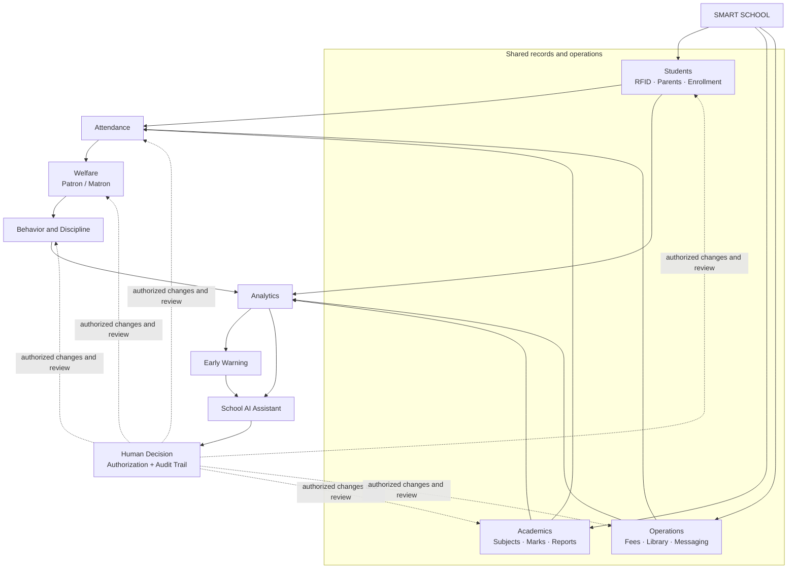

# Smart School System Architecture

## Architecture overview

The system is one Flask-backed school platform. Students, academic structure, enrollment, staff roles, and school-year context are shared records. Operational modules use those records rather than creating separate copies. Attendance, welfare, behavior, academic, finance, library, and communication events provide traceable inputs to reports and analytics. Early warnings and the School AI Assistant may summarize those inputs, but authorized staff make consequential decisions and every sensitive action remains auditable.

The arrows show data and review flow, not a requirement that every workflow must pass through every preceding box. For example, a fee reconciliation can be reviewed directly by an accountant; welfare facts do not automatically become discipline findings.

## System boundaries and rules

- **Shared identity:** one student account and permanent student identity, with guardian links and academic-year enrollment history. The legacy `User` student fields remain compatible during incremental migration.
- **Academic records:** subjects, teacher assignments, assessment results, approvals, and report cards are scoped by role, class, subject, term, and academic year.
- **Attendance:** RFID scans are inputs. The server applies card, enrollment, class, date, and time rules. Staff corrections append an audit event; they do not erase the original decision history.
- **Welfare:** Patron and Matron records remain factual and separately scoped. Welfare status can inform attendance explanations and authorized reports, but does not silently alter attendance or create a discipline decision.
- **Behavior and discipline:** reports follow review and resolution workflows. AI may surface patterns with supporting records; it cannot assign punishment or change academic results.
- **Operations:** fees, library, inventory, messages, and requests use the same student, staff, class, and year references wherever applicable. Financial records require reconciliation and preserve decision history.
- **Analytics and early warning:** aggregates must be traceable to underlying records. An indicator is a prompt for review, not a causal claim or an automatic decision.
- **School AI Assistant:** every query uses the same server-side permissions and data scopes as the corresponding application screen. Responses distinguish stored facts from estimates and recommendations.
- **Human decision and audit:** approval, publication, financial adjustment, discipline action, identity change, report correction, and other consequential mutations require authorized users and an auditable actor, timestamp, reason, and target record.

## Mapping to the current repository

| Architecture area | Current implementation | Work still needed |
| --- | --- | --- |
| Student identity and enrollment | `User`, `StudentGuardian`, `AcademicYear`, `AcademicEnrollment`; student and guardian routes | Complete enrollment lifecycle and backfill coverage; avoid current-class text as the sole historical source |
| RFID and attendance | `/student/rfid-login` now writes authenticated scan events to `RFIDScanLog` with server time, device ID, outcome, and duplicate status; daily attendance remains in `Attendance`; corrections use `AttendanceAuditTrail` | Complete enrollment gating and report snapshot/revision workflow; cover device/card outcomes and retry behavior in integration tests |
| Academics | Subjects, timetable, grades, assessments, report-card approval, learning materials | Teaching assignments and result publication need complete year/term-scoped lifecycle coverage |
| Welfare | Patron/Matron roles, welfare records, daily reports, review and audit services | Verify all class/gender scope behavior and complete monthly/annual summaries |
| Behavior and discipline | Separate behavior records and discipline cases with role-scoped routes | Continue severity, intervention, review, parent delivery, retention, and trend work |
| Operations | Fees and payment reconciliation, library, meetings, messages, announcements | Inventory, expenses, staff reporting, and general resource requests are not complete workflows |
| Analytics and early warning | Dashboards and domain reports exist | Unified school-to-department-to-trade-to-class drill-down and evidence-backed early-warning workflow remain incomplete |
| School AI Assistant | No complete permission-aware school AI assistant route/service is present | Add only after each data source has permission checks, provenance, audit, and human-confirmed actions |
| Human decision and audit | Role access registry, meeting/message/welfare/activity audit models, fee reconciliation fields | Audit coverage is uneven; formal authorization and immutable change history need broader coverage |

## Implementation constraint

Keep Flask, SQLAlchemy, existing session authentication, and route authorization as the system of record. New screens may use the incremental React frontend, but they must call server-authorized APIs. Introduce schema changes through idempotent migrations and retain existing workflows until equivalent behavior and scope checks are in place. This architecture extends the current app; it does not call for replacing working modules with disconnected applications.

Related requirements are in [SDMS-inspired FURPS Requirements](sdms-furps-parity.md), and frontend migration boundaries are in [the React migration plan](react-migration-plan.md).
